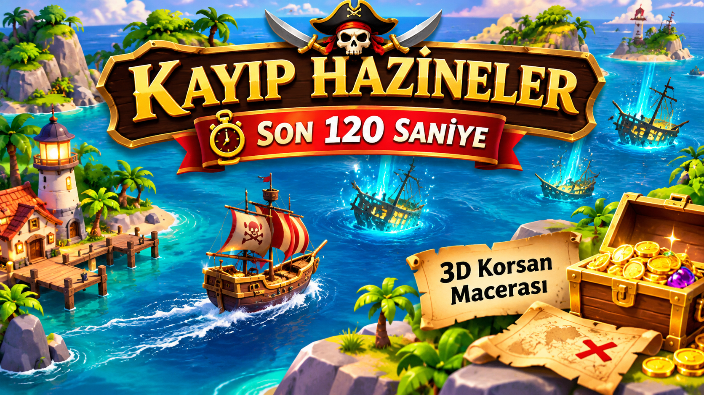

# Kayıp Hazineler: Son 120 Saniye

🇹🇷 **Türkçe** | 🇬🇧 [English](README_EN.md)



<sub>Kapak görseli projeye ait bir tanıtım görselidir ve yapay zekâ ile üretilmiştir; oyun içi ekran görüntüsü değildir.</sub>

Masalsı, renkli bir korsan dünyasında geçen kısa bir hazine avı oyunu. Gemini sür,
üç batıktaki eserleri 120 saniye dolmadan çıkar, limana dön ve eserleri açık
artırmada sat. Kazandığın altına göre korsan rütbeni öğren!

🎬 **Tanıtım videosu:** [YouTube'da izle](https://youtu.be/DNKE-yRdeuQ)

## Özellikler

- 120 saniyelik zamana karşı görev; süre yalnızca oyun duraklatılınca durur
- Üç batık: Mercan Koyu (kolay), Sisli Geçit (orta), Derin Mavi (zor)
- Batıkların yaklaşık arama bölgelerini gösteren hazine haritası (harita açıkken süre akmaya devam eder)
- Risk ve ödül dengeli açık artırma: teklifi kabul et ya da daha yüksek teklif bekle
- Üç korsan rütbesi: Acemi Korsan, Usta Hazine Avcısı, Denizlerin Efsanesi
- Türkçe arayüz, özgün müzik ve ses efektleri, ayarlanabilir ses seviyeleri

## Kontroller

| Tuş | İşlev |
|---|---|
| W / ↑ | İleri |
| S / ↓ | Önce fren, durunca geri |
| A / D veya ← / → | Dön |
| E (basılı tut) | Batığın yanında, gemi dururken hazineyi çıkar (3 saniye) |
| M | Hazine haritasını aç / kapat |
| Esc | Duraklat |
| Enter, ok tuşları | Menülerde seçim |

## Oyun kuralları

- Üç eseri de topla ve süre bitmeden limana dön. Eksik eserle limana gelirsen görev bitmez.
- Hazineyi çıkarmak için batığa yaklaş, gemiyi durdur ve **E**'yi 3 saniye basılı tut. Erken bırakırsan, uzaklaşırsan ya da gemi hareket ederse çıkarma yarıda kalır.
- Açık artırmada eserler sırayla satılır: Kayıp Pusula 100, Kraliyet Tacı 180, Okyanus Safiri 300 altınla başlar.
  - Beklersen %70 olasılıkla teklif yükselir (×1,5, ikinci beklemede ×2,2), %30 olasılıkla alıcılar çekilir ve o eserden altın kazanamazsın.
  - Her eser için en fazla iki kez beklenebilir; ikinci başarılı beklemede teklif otomatik kabul edilir.
- Rütbeler: 0–649 Acemi Korsan · 650–999 Usta Hazine Avcısı · 1000+ Denizlerin Efsanesi

## Kurulum ve çalıştırma

1. [Godot Engine 4.7.2](https://godotengine.org/download/archive/) (standart sürüm, .NET gerekmez) indir.
2. Bu depoyu indir (**Code → Download ZIP**) veya klonla.
3. Godot'u aç, **İçe Aktar** ile proje klasöründeki `project.godot` dosyasını seç.
4. İlk açılışta Godot dosyaları içe aktarır (birkaç saniye sürebilir); ardından **F5** ile oyunu başlat.

## Kullanılan teknolojiler

- **Godot Engine 4.7.2**, Compatibility (OpenGL) renderer — entegre ekran kartlarında da akıcı çalışacak şekilde ayarlandı
- **GDScript** — oyun mantığı, arayüz ve açık artırma
- **Godot gölgelendiricileri** — çizgi film tarzı ışıklandırma, su, köpük, şelale ve sahte ışıltı efektleri
- **Prosedürel 3D** — adalar, kayalar, liman, gemi ve batıklar kodla üretilir; dışarıdan 3D model kullanılmadı
- **Python** (yalnızca standart kütüphane) — müzik ve ses efektlerinin üretimi (`tools/`)

## Proje yapısı

| Klasör | İçerik |
|---|---|
| `scenes/` | Oyun sahneleri |
| `scripts/` | Oyun kodu (GDScript) |
| `shaders/` | Gölgelendiriciler |
| `assets/audio/` | Müzik ve ses efektleri, kaynak ve lisans bilgisi (`KAYNAKLAR.md`) |
| `assets/fonts/` | Yazı tipleri ve lisans dosyaları |
| `tests/` | Otomatik testler (`tests/README.md`) |
| `tools/` | Seslerin üretim betikleri |
| `ASAMALAR.md` | Geliştirme aşamaları ve test kayıtları |
| `docs/images/` | README görselleri (kapak görseli) |

## Testler

`tests/` klasöründeki betikler oyunu gerçek pencerede, klavye girdileriyle sınar
(rota ve gemi kontrolü, hazine çıkarma, harita, açık artırma, ses, 120 saniyelik
geri sayım, görünürlük ve performans). Uçtan uca test, oyunu menüden sonuç ekranına
kadar baştan sona oynar. Godot konsol sürümüyle proje klasöründe çalıştırılır:

```
Godot_v4.7.2-stable_win64_console.exe --path . -s tests/uctan_uca.gd -- mod=kazanma
Godot_v4.7.2-stable_win64_console.exe --path . -s tests/ses.gd
```

Her test sonunda `SONUÇ: hata sayısı = N` yazdırır. Ayrıntılar ve tüm testlerin
listesi `tests/README.md` dosyasındadır.

### Bilinen sınırlamalar

- Hazine haritası açıkken FPS, hedeflenen 100 FPS'in sınırında ölçüldü (AMD Radeon Vega 8 üzerinde ortalama ≈ 99).
- Gemi bazı ada kıyılarına ve limandaki evlerin kuzeyine çok yaklaştığında, öndeki palmiye, kaya veya çatıların arkasında kısmen kalabilir.
- Duraklatmadan devam edildiğinde, sürmekte olan hazine çıkarmasının sesi yeniden başlamaz (çıkarma tamamlanır).
- İlk açılışlarda (menü, ilk keşif, açık artırma) kısa, tek karelik takılmalar görülebilir.

## Lisanslar ve atıflar

Bu depodaki dosyalar farklı lisanslara tabidir:

| Dosyalar | Lisans |
|---|---|
| Kaynak kod: GDScript, sahne ve ayar dosyaları, gölgelendiriciler, testler, `tools/` betikleri | [MIT Lisansı](LICENSE) © 2026 Beyza Uzun |
| `assets/fonts/Baloo2-Variable.ttf` — Baloo 2, The Baloo 2 Project Authors | [SIL Open Font License 1.1](assets/fonts/Baloo2-OFL.txt) |
| `assets/fonts/Fredoka-Variable.ttf` — Fredoka, The Fredoka Project Authors (oyunda kullanılmıyor) | [SIL Open Font License 1.1](assets/fonts/OFL.txt) |
| `assets/audio/amb_waves_beach.wav` — "Gentle Waves – Quiet Beach", amholma ([Freesound](https://freesound.org/people/amholma/sounds/376795/)), düzenlenmiş bölüm | [CC0 1.0](https://creativecommons.org/publicdomain/zero/1.0/) |
| Diğer tüm sesler ve müzikler (`assets/audio/`) ile `icon.svg` — bu proje için üretildi | © 2026 Beyza Uzun, tüm hakları saklıdır (MIT lisansı kapsamında değildir) |
| `docs/images/kayip-hazineler-kapak.png` — projeye ait tanıtım görseli, yapay zekâ ile üretildi | MIT lisansı kapsamında değildir; kullanım için izin alınmalıdır |

Ses kaynaklarının ayrıntıları `assets/audio/KAYNAKLAR.md` dosyasındadır. Tasarım
sürecinde yapay zekâ ile üretilmiş referans görseller kullanıldı; bu görseller
oyunda yer almaz ve depoya dâhil edilmedi.

## Geliştirme

Bu oyun, GameUp yapay zekâ destekli oyun geliştirme eğitimi kapsamında Godot 4.7.2
ile geliştirildi.
