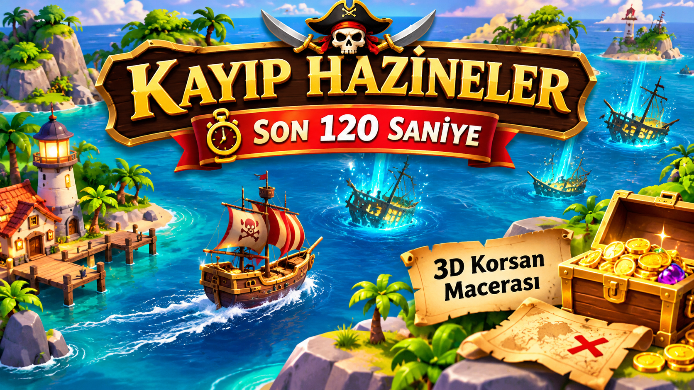

# Kayıp Hazineler: Son 120 Saniye

🇹🇷 [Türkçe](README.md) | 🇬🇧 **English**



<sub>The cover image is a promotional image created for this project with artificial intelligence; it is not an in-game screenshot.</sub>

*Kayıp Hazineler: Son 120 Saniye* ("Lost Treasures: The Last 120 Seconds") is a short
treasure-hunting game set in a colorful, storybook pirate world. Sail your ship,
recover the artifacts from three shipwrecks before the 120 seconds run out, return
to port and sell them at auction. Your pirate rank depends on the gold you earn!

🎬 **Trailer:** [Watch on YouTube](https://youtu.be/DNKE-yRdeuQ)

## Features

- A 120-second race against the clock; the timer only stops while the game is paused
- Three shipwrecks: Mercan Koyu / Coral Cove (easy), Sisli Geçit / Misty Pass (medium), Derin Mavi / Deep Blue (hard)
- A treasure map showing the approximate search area of each wreck (the timer keeps running while the map is open)
- A risk-and-reward auction: accept the offer or wait for a higher bid
- Three pirate ranks: Acemi Korsan (Novice Pirate), Usta Hazine Avcısı (Master Treasure Hunter), Denizlerin Efsanesi (Legend of the Seas)
- Turkish user interface, original music and sound effects, adjustable volume levels

## Controls

| Key | Action |
|---|---|
| W / ↑ | Forward |
| S / ↓ | Brake first, then reverse once stopped |
| A / D or ← / → | Turn |
| E (hold) | Recover the treasure next to a wreck while the ship is stopped (3 seconds) |
| M | Open / close the treasure map |
| Esc | Pause |
| Enter, arrow keys | Select in menus |

## Game rules

- Collect all three artifacts and return to port before time runs out. Arriving at port with missing artifacts does not end the mission.
- To recover a treasure, sail close to the wreck, stop the ship and hold **E** for 3 seconds. Releasing E early, sailing away or letting the ship move interrupts the recovery.
- At the auction the artifacts are sold one at a time. Starting offers: Kayıp Pusula (Lost Compass) 100, Kraliyet Tacı (Royal Crown) 180, Okyanus Safiri (Ocean Sapphire) 300 gold.
  - If you wait, there is a 70% chance the offer rises (×1.5, and ×2.2 on the second wait) and a 30% chance the buyers withdraw, leaving you with no gold for that artifact.
  - You can wait at most twice per artifact; after the second successful wait the offer is accepted automatically.
- Ranks: 0–649 Acemi Korsan (Novice Pirate) · 650–999 Usta Hazine Avcısı (Master Treasure Hunter) · 1000+ Denizlerin Efsanesi (Legend of the Seas)

## Installation and running

1. Download [Godot Engine 4.7.2](https://godotengine.org/download/archive/) (standard version; .NET is not required).
2. Download this repository (**Code → Download ZIP**) or clone it.
3. Open Godot, click **Import** and select the `project.godot` file in the project folder.
4. On first launch Godot imports the files (this may take a few seconds); then press **F5** to start the game.

## Technologies

- **Godot Engine 4.7.2**, Compatibility (OpenGL) renderer — tuned to run smoothly on integrated graphics as well
- **GDScript** — game logic, user interface and auction
- **Godot shaders** — cartoon-style lighting, water, foam, waterfall and fake glow effects
- **Procedural 3D** — islands, rocks, port, ship and wrecks are generated in code; no external 3D models are used
- **Python** (standard library only) — generation of the music and sound effects (`tools/`)

## Project structure

| Folder | Contents |
|---|---|
| `scenes/` | Game scenes |
| `scripts/` | Game code (GDScript) |
| `shaders/` | Shaders |
| `assets/audio/` | Music and sound effects, source and license information (`KAYNAKLAR.md`, in Turkish) |
| `assets/fonts/` | Fonts and their license files |
| `tests/` | Automated tests (`tests/README.md`, in Turkish) |
| `tools/` | Sound generation scripts |
| `ASAMALAR.md` | Development stages and test records (in Turkish) |
| `docs/images/` | README images (cover image) |

## Tests

The scripts in the `tests/` folder exercise the game in a real window using keyboard
input (route and ship control, treasure recovery, map, auction, audio, the
120-second countdown, visibility and performance). The end-to-end test plays the
game from start to finish, from the main menu to the results screen. Run them from
the project folder with the Godot console executable:

```
Godot_v4.7.2-stable_win64_console.exe --path . -s tests/uctan_uca.gd -- mod=kazanma
Godot_v4.7.2-stable_win64_console.exe --path . -s tests/ses.gd
```

Each test ends by printing `SONUÇ: hata sayısı = N` ("RESULT: error count = N").
Details and the full list of tests are in `tests/README.md`.

### Known limitations

- With the treasure map open, the frame rate was measured right at the 100 FPS target (≈ 99 FPS on average on an AMD Radeon Vega 8).
- When the ship sails very close to some island shores or to the north side of the port houses, it can be partly hidden behind palm trees, rocks or roofs in front of it.
- After resuming from pause, the sound of an ongoing treasure recovery does not restart (the recovery still completes).
- Short, single-frame stutters may occur the first time some screens appear (menu, first discovery, auction).

## Licenses and attributions

The files in this repository are covered by different licenses:

| Files | License |
|---|---|
| Source code: GDScript, scene and configuration files, shaders, tests, `tools/` scripts | [MIT License](LICENSE) © 2026 Beyza Uzun |
| `assets/fonts/Baloo2-Variable.ttf` — Baloo 2, The Baloo 2 Project Authors | [SIL Open Font License 1.1](assets/fonts/Baloo2-OFL.txt) |
| `assets/fonts/Fredoka-Variable.ttf` — Fredoka, The Fredoka Project Authors (not used in the game) | [SIL Open Font License 1.1](assets/fonts/OFL.txt) |
| `assets/audio/amb_waves_beach.wav` — "Gentle Waves - Quiet Beach" by Freesound user amholma ([Freesound](https://freesound.org/people/amholma/sounds/376795/)), edited excerpt | [CC0 1.0](https://creativecommons.org/publicdomain/zero/1.0/) — attribution is not required; the source is credited for transparency and at the uploader's request |
| All other sounds and music (`assets/audio/`) and `icon.svg` — created for this project | © 2026 Beyza Uzun, all rights reserved (not covered by the MIT License) |
| `docs/images/kayip-hazineler-kapak.png` — promotional image for this project, created with artificial intelligence | Not covered by the MIT License; permission is required for use |

The MIT License applies only to the source code. Third-party fonts and audio remain
under their own licenses, and the project's own sounds, music and icon are not
covered by the MIT License. Details of the audio sources are in
`assets/audio/KAYNAKLAR.md` (in Turkish). AI-generated reference images were used
during the design process; they are not part of the game and are not included in
this repository.

## Development

This game was developed with Godot 4.7.2 as part of the GameUp AI-assisted game
development training program.
